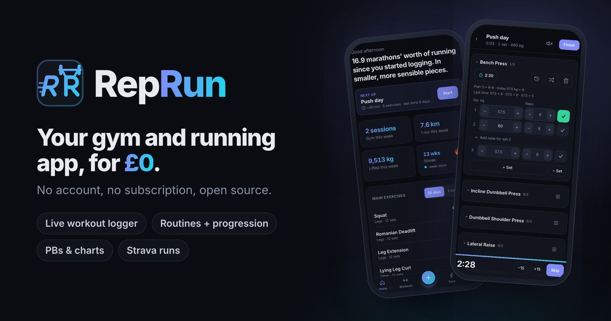

# RepRun



A private gym and running dashboard you host yourself, for free, on Cloudflare.

**Look around:** <https://demo.danielhadaway.dev> (made-up data, resets every night)

**Use it for real, no setup:** <https://app.reprun.co.uk>. Add it to your home screen and your training stays
on your phone only: no account, no server. Save a backup file now and then (Settings → Backup); deleting the app
deletes the data. Restore that file into your own copy whenever you want it synced.

- **Log workouts as you train**, on your phone. It installs to your home screen like an app, keeps
  the screen on, runs a rest timer with a beep, and still works with no signal at the gym.
- **Routines from your PT or ChatGPT.** Paste the plan as text, and each day becomes a routine with
  suggested weights and reps from last time (double progression).
- **History and progress:** PBs per exercise, estimated 1RM, charts, strength levels and a year in
  review.
- **Runs from Strava**, matched up with your gym days.
- **Your data stays yours**, in your own Cloudflare database behind your own login.

**Set up your own** in about 10 minutes, free, no domain needed:

[](https://deploy.workers.cloudflare.com/?url=https://github.com/dannyhadders/reprun)

Then follow [docs/SETUP.md](docs/SETUP.md) to add the login and put it on your phone. Prefer a
terminal? `npm run setup` does it from a clone. Or ask Claude Code or Cursor: *"Read
docs/SETUP-AI.md and set up RepRun for me."*

## Stack

React + Vite + Tailwind 4 + Chart.js, served by one Cloudflare Worker with a D1 (SQLite) database.

```
src/        the web app (pages, phone logger, charts, stats)
worker/     the API (/api/*) on Cloudflare Workers
shared/     code both sides use: types, plan parser, exercise catalogue, Strava mapping, demo data
migrations/ database schema
scripts/    seed.ts (load a workbook), config.mjs (fills your settings in at build time)
```

## Try it locally

```sh
npm install
cp .dev.vars.example .dev.vars   # add DEMO=1 to it for made-up data, or leave it to start blank
npm run db:migrate               # create the local database (first time only)
npm run dev                      # http://localhost:5173
```

Everything runs offline. The database is a local SQLite file under `.wrangler/`.

## Getting data in

- **The phone logger:** tap the big + and either start a routine or start an empty workout.
- **Routines:** + → Import plan. Paste plain text, for example `Bench Press – 3x8-10 @ 60kg, rest 90s`.
  There's a button there that copies a ready-made prompt for ChatGPT.
- **Add a past workout or run:** on the phone, More → Add past workout. On a computer, the button
  in the sidebar.
- **A backup file:** Settings → Backup. Restoring merges, so nothing is duplicated or overwritten.
- **Strava:** Settings → Connect, then Sync now. The first sync backfills everything.
- **Spreadsheet:** Settings → Import spreadsheet reads a workbook with `Set Log`,
  `Session Summary`, `Running Log`, `PBs & Benchmarks` and `Progress & Targets` sheets. It's
  specific to one person's format, so treat it as an example to adapt.
- New exercise names come in as they're written. Map aliases to one name and muscle group in
  `shared/catalogue.ts`.

## Notes

- **Estimated 1RM** uses Epley (`weight × (1 + reps / 30)`) and skips sets over 12 reps.
- **PBs** follow Hevy: at most one per exercise per session, when its best set beats every earlier
  session. Heaviest weight wins first, then estimated 1RM, then reps for bodyweight moves.
- **Strength levels** (`src/lib/standards.ts`) are rough bands based on published lifter
  standards, not a dataset. Good for motivation, not for science.
- **Durations** come from the logger's clock, or from a matching Strava activity. Otherwise
  they're estimated at about 3 minutes per set and marked "est.".

MIT licensed.
